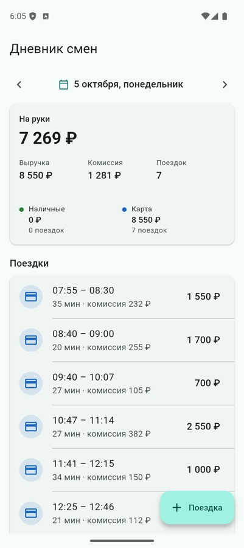

# Дневник смен водителя

Мобильное приложение на Flutter (Android / iOS) и REST-сервер на Dart (shelf).
Водитель видит сводку за день (поездки, выручка, комиссия, «на руки»,
наличные/карта) и список поездок, листает дни и добавляет поездки.

<p>
  
  
  
</p>

## Как запустить

Нужен Flutter 3.41+ (Dart 3.11+).

```bash
# 1. Сервер (порт 8080)
cd server
dart pub get
dart run bin/server.dart

# 2. Приложение — в другом терминале, из корня репозитория
flutter pub get
flutter run                 # Android-эмулятор / iOS-симулятор
```

Клиент по умолчанию ходит на `http://10.0.2.2:8080` на Android-эмуляторе
и на `http://localhost:8080` на iOS-симуляторе и в вебе. На реальном
устройстве укажите IP компьютера:

```bash
flutter run --dart-define=API_BASE_URL=http://192.168.1.10:8080
```

Тесты:

```bash
cd server && dart test      # сервер: сводка, защита от дублей, валидация, API
flutter test                # клиент: маппинг времени, ошибки API, кубиты
```

Кодогенерация (freezed, json_serializable, retrofit, injectable) уже
закоммичена. Пересобрать: `dart run build_runner build --delete-conflicting-outputs`.

## API

| Метод | Путь | Что делает |
|---|---|---|
| `GET` | `/days` | дни, в которых есть поездки: `{"days": ["2026-10-01", …]}` |
| `GET` | `/days/{yyyy-MM-dd}` | `{date, summary, trips}`: сводка и поездки за день по порядку |
| `POST` | `/trips` | добавить поездку |

```bash
curl localhost:8080/days/2026-10-01

curl -X POST localhost:8080/trips -d '{"id":"t100",
  "start":"2026-10-06T10:00:00+05:00","end":"2026-10-06T10:20:00+05:00",
  "amount":800,"payment":"cash","commission":120}'
```

Ответы `POST /trips`:

| Код | Когда |
|---|---|
| `201` | поездка создана |
| `200` | повтор: тот же `id` с теми же данными. Дубль не создаётся, в ответе уже записанная поездка |
| `400` | не прошла проверка; в `details` все ошибки по полям сразу |
| `409 id_conflict` | тот же `id`, но другие данные |
| `409 overlap` | другой `id`, но время пересекается с записанной поездкой |

Сводка:

```json
{"tripsCount": 2, "revenue": 3900, "commission": 585, "net": 3315,
 "cash": {"count": 1, "revenue": 1500}, "card": {"count": 1, "revenue": 2400}}
```

## Что сделано и почему так

### Защита от дублей — на двух уровнях

1. **Идемпотентность по `id`.** `id` генерирует клиент (UUID) при
   отправке формы. Если ответ не дошёл (таймаут, обрыв сети) и водитель
   жмёт «Сохранить» ещё раз, уходит **тот же** `id`, и сервер отвечает
   `200` вместо создания второй записи. Если водитель успел изменить данные,
   генерируется новый `id`: это уже другая поездка.
2. **Пересечение по времени.** Водитель не может везти два заказа сразу,
   поэтому поездка, пересекающаяся с уже записанной, отклоняется (`409`).
   Так ловится та же поездка, отправленная под новым `id`: из другого
   клиента, повторным импортом и т. п. Интервалы полуоткрытые: поездка
   встык (08:32 → 08:32) допустима.

Проверка и вставка выполняются синхронно в одном изоляте, поэтому гонки
двух одновременных одинаковых POST нет.

### Время и «день»

- Время — ISO 8601 **с обязательным смещением**. Строка без смещения
  отклоняется: по ней нельзя понять, к какому дню относится поездка.
- День поездки — календарный день **по часам водителя** (по смещению из
  данных), а не по UTC. `DateTime.parse` в Dart переводит строку в UTC и
  смещение теряет: поездка `2026-10-01T02:00+05:00` уехала бы в 30 сентября.
  Поэтому смещение хранится рядом с моментом (`OffsetDateTime` / `TripTime`).
- Ночная поездка (23:48 → 00:21) относится к дню **начала**. В форме для
  неё есть переключатель «Закончилась после полуночи».
- Время в списке показывается по часам водителя, а не по часовому поясу
  телефона.
- `DateTime.parse` молча нормализует `2026-02-30` в 2 марта, а
  `2026-13-01` переносит на следующий год. Такие даты отклоняются.

### Деньги

Суммы — **целые рубли** (`int`), как в примере данных. `2400.0` принимается,
`2400.5` нет. `double` для денег даёт ошибки округления в сводке.

«На руки» = выручка − комиссия, то есть заработок водителя независимо от
способа оплаты. Разбивка наличные/карта показывает, как пришла выручка.

### Проверки при добавлении

`id` — непустая строка; `start`/`end` — валидные даты со смещением, окончание
позже начала; `amount` > 0; `commission` от 0 до `amount`; `payment` —
`cash` или `card`. Клиент проверяет то же самое до отправки, но источник
истины — сервер: его ошибки раскладываются по полям формы.

### Хранение

При первом старте сервер читает `server/data/trips.json` (исходные данные,
41 поездка за 1–5 октября 2026; первые две — из примера задания). Добавленные
поездки сохраняются в `server/.data/trips.json`, исходный файл не меняется.
Запись атомарная (временный файл + rename). Чтобы начать заново, удалите
`server/.data/`. Битая или пересекающаяся запись в файле роняет старт сервера
с понятной ошибкой, а не тихо портит сводку.

Пути и порт настраиваются через `PORT`, `SEED_FILE`, `STORE_FILE`.

### Клиент

- При открытии показывается последний день, в котором есть поездки
  (демо-данные в прошлом), дальше стрелки ← → и выбор даты в календаре.
- Если быстро листать дни, ответы могут прийти не по порядку. Применяется
  только ответ на последний запрос.
- После добавления поездки день перечитывается с сервера: сводку считает
  только сервер, правило расчёта живёт в одном месте.

## Архитектура

```
server/                          Dart, shelf
├── bin/server.dart              запуск, настройки
├── data/trips.json              исходные данные
└── lib/src/
    ├── domain/                  Trip, OffsetDateTime, DaySummary (расчёт), TripStore (дубли)
    ├── data/                    TripJson (разбор + валидация), TripsFile (загрузка/сохранение)
    └── api/                     TripsApi (роуты), CORS

lib/                             Flutter-клиент
├── domain/
│   ├── model/                   Trip, TripTime, DaySummary, DayReport (freezed), ошибки
│   └── repository/              TripsRepository (контракт)
├── data/
│   ├── dto/                     json_serializable
│   ├── remote/                  TripsApi (retrofit поверх Dio)
│   ├── mapper/                  DTO ↔ модель, разбор времени со смещением
│   └── repository/              TripsRepositoryImpl: 400/409 → доменные ошибки
├── presentation/
│   ├── day/                     DayCubit + экран дня и виджеты
│   └── add_trip/                AddTripCubit + шторка добавления
├── injectable/                  DI (get_it + injectable)
└── utils/                       форматирование, цвета
```

Слои data / domain / presentation, Cubit как презентер: repository
вызывается напрямую, без отдельного слоя use case, потому что бизнес-логика
(сводка, дубли) живёт на сервере. Вся логика экранов в кубитах, виджеты
только рисуют стейт.

## Тесты

**Сервер** (`server/test`, 41 тест):
- `day_summary_test`: расчёт сводки (пример из задания, пустой день,
  разбивка в сумме даёт выручку);
- `trip_store_test`: дубли (повтор, тот же id с другими данными, тот же
  момент под новым id, пересечение через разные смещения, поездка встык),
  день по часам водителя, ночные поездки;
- `trip_json_test`: валидация всех полей, несуществующие даты, доли секунды;
- `trips_api_test`: HTTP-уровень (201 → 200 при повторе, 409, 400) и
  исходный файл данных.

**Клиент** (`test/`, 30 тестов): маппинг времени со смещением, разбор
ошибок API, `DayCubit` (стартовый день, переключение, гонка ответов, retry),
`AddTripCubit` (тот же id при повторе, новый id при изменении, валидация,
ошибки сервера по полям).

## Что не сделано

- Нет авторизации и нескольких водителей: один дневник.
- Нет редактирования и удаления поездок.
- Хранилище — JSON-файл и память. Для продакшена нужна БД с
  уникальным индексом по `id` и exclusion-ограничением на интервал
  (в PostgreSQL — `EXCLUDE USING gist`).
- Нет офлайн-очереди: если сервер недоступен, поездку нужно отправить
  повторно вручную (дубль при этом не создастся).
